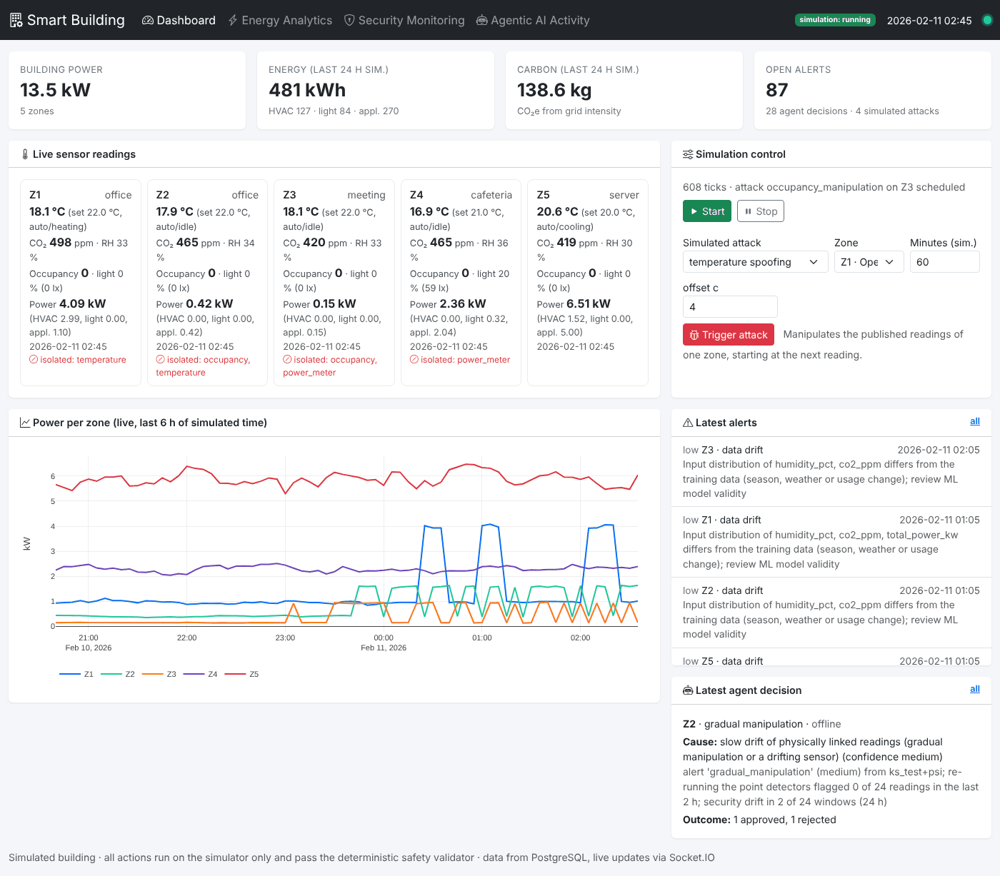

# Smart Building Energy Optimization

**Real-time streaming, cybersecurity and agentic AI for smart-building energy management.**

Final-year engineering project. A simulated multi-zone building streams sensor data through
Apache Kafka. Independent workers persist the data to PostgreSQL, predict energy use with ML,
optimise HVAC and lighting, and detect cyberattacks, anomalies and data drift. An agentic AI
proposes corrective actions, and every action must pass a deterministic safety layer before it
is executed. A Flask + Socket.IO dashboard shows everything live.

## Quick start (Windows)

```powershell
scripts\windows\setup.bat     # once: .venv, packages, .env (if missing), Docker, data + models
scripts\windows\start.bat     # every time: preflight, 9 workers + dashboard → http://127.0.0.1:5000
scripts\windows\verify.bat    # optional: end-to-end verification in an isolated database
```

There are two more guides:

- [`docs/EXECUTION_GUIDE.md`](docs/EXECUTION_GUIDE.md): the step-by-step guide, including
  troubleshooting.
- [`docs/ARCHITECTURE.md`](docs/ARCHITECTURE.md): the final architecture, covering processes,
  topics, control modes, state ownership and concurrency.

## Architecture

```
dashboard (Flask) ──► simulation_control ──► [simulation_manager: simulator + attacks + actuator]
                                                      │ building_sensor_data
     ┌────────────────┬──────────────────┬────────────┼───────────────────┬─────────────────────┐
[sensor_persistence] [energy_processor] [prediction_service] [optimization_service] [security_service]
     │ readings       │ energy + CO₂e    │ energy_predictions │ optimization_commands │ security_alerts
     ▼                ▼                  ▼                    ▼                       ▼
 PostgreSQL ◄── [record_persistence] ◄── weather/carbon ◄── [external_data_publisher]   [agent_service:
     │                                                                                  LangGraph agent →
     └──► dashboard pages + Socket.IO live push                                         safety validator]
  approved commands (agent; + optimizer in closed loop) ──► simulation_manager ──► agent_actions (executed)
```

Design rules:
- Kafka is the event backbone.
- Each worker is its own process.
- Flask never consumes Kafka directly.
- AI actions are always validated by the safety layer before they run.

## Project structure

| Path | Purpose |
|---|---|
| `config.py` | Central, environment-driven configuration (Flask, Socket.IO, Kafka, PostgreSQL, logging) |
| `utils/logging_config.py` | Structured JSON/text logging, one log file per service |
| `app.py` | Flask application factory (wiring only) |
| `scripts/check_environment.py` | Verifies Python, packages, configuration and service connectivity |
| `scripts/run_stack.py` | Starts and supervises every worker plus the dashboard (restart with backoff, graceful stop) |
| `scripts/preflight.py`, `scripts/bootstrap.py`, `scripts/verify_system.py` | Start-up checks, one-time data/model setup, end-to-end verification |
| `scripts/windows/` | `setup`, `start`, `stop`, `verify` (PowerShell + `.bat`) |
| `simulator/` | Five-zone building physics, occupancy, outdoor climate, sensor and attack simulation |
| `docs/sample_output/` | Sample simulator output (JSON Lines) |
| `streaming/` | Kafka topic registry, JSON producer/consumer, connection helpers (named `streaming` so it does not shadow Kafka client libraries) |
| `workers/` | Long-running services, one process each (sensor publisher, persistence workers, topic monitor) |
| `processors/` | Message validation, feature engineering, energy/carbon calculations (no I/O) |
| `database/` | PostgreSQL schema (`schema.sql`), connection pool, records, repositories, admin CLI |
| `data_sources/` | Weather (Open-Meteo) and carbon-intensity (Electricity Maps, UK grid) providers, cached HTTP client, mock providers |
| `ml/` | Energy prediction: dataset loading, leakage-safe features, models, training, evaluation, model registry, inference |
| `docs/results/` | Generated evaluation reports (from real training runs) |
| `optimization/` | Deterministic SciPy HVAC/lighting optimizer, energy model, lighting rules, constraints/validator |
| `security/` | Rule-based validation, Isolation Forest, KS/PSI drift detection, attack classification, alerts, training |
| `agent/` | Agentic AI: LangGraph incident agent, tools, LLM providers, deterministic safety validator, simulated execution, decision records |
| `routes/`, `templates/`, `static/` | Flask dashboard: pages, JSON API, Bootstrap/Plotly/Socket.IO front end |
| `services/` | Dashboard service layer: PostgreSQL queries, simulation-control publisher, live-update poller |
| `experiments/` | Closed-loop baseline vs. optimized comparison, labelled cyberattack evaluation, KAG real-data analyses, Module 11 end-to-end evaluation (`evaluation.py`, `evaluation_report.py`, `streaming_latency.py`) |
| `docker/` | Kafka and PostgreSQL containers |
| `tests/` | Unit tests (pytest) |

## Setup (Windows)

Requirements: Python 3.10–3.13 (3.12 recommended) and Git. Docker Desktop is needed later
for Kafka and PostgreSQL.

```powershell
git clone https://github.com/priy4nsh408/Energy_Optimization.git
cd Energy_Optimization
py -3.12 -m venv .venv
.venv\Scripts\activate
python -m pip install --upgrade pip
pip install -r requirements.txt
copy .env.example .env
```

On Linux/macOS, use `python3 -m venv .venv`, `source .venv/bin/activate` and
`cp .env.example .env` instead.

If PowerShell blocks `activate`, run
`Set-ExecutionPolicy -Scope CurrentUser RemoteSigned` once.

## Configuration

All settings come from environment variables. A local `.env` file is loaded automatically.
Real environment variables always override `.env`, and `.env` is git-ignored.
`.env.example` documents every variable.

`APP_ENV` selects the environment:

| `APP_ENV` | Behaviour |
|---|---|
| `development` (default) | Flask debug mode, `DEBUG` logging, random `SECRET_KEY` if none is set |
| `testing` | Database name gets a `_test` suffix, Kafka topics get a `test.` prefix, console-only `WARNING` logging |
| `production` | `SECRET_KEY` (≥ 32 chars) and `POSTGRES_PASSWORD` are required |

Invalid values (e.g. `FLASK_PORT=abc`) fail fast with a clear `ConfigurationError`.

In code:

```python
from config import get_config
cfg = get_config()
cfg.KAFKA.producer_config()            # dict for confluent_kafka.Producer
cfg.KAFKA.consumer_config("db_writer") # each service uses its own consumer group
cfg.KAFKA.topic("sensor.readings")     # physical topic name (with prefix)
cfg.DATABASE.connection_kwargs()       # kwargs for psycopg.connect
```

## Building simulator

The simulator (`simulator/`) models five independent zones and emits one timestamped
JSON event per zone per reading. It does not depend on Kafka or the dashboard: events go
to a *sink* callable (stdout/file now, a Kafka producer in the streaming module).

| Zone | Type | Area | Capacity | Notes |
|---|---|---|---|---|
| Z1 Open-plan office | office | 300 m² | 30 | Lights follow the schedule (baseline waste) |
| Z2 Private offices | office | 120 m² | 8 | Lights follow occupancy |
| Z3 Meeting room | meeting | 60 m² | 12 | Hourly bookings, high ventilation |
| Z4 Cafeteria and lobby | cafeteria | 200 m² | 60 | Lunch peak, security lighting at night |
| Z5 Server room | server | 40 m² | 2 | 24/7 IT load and cooling |

**How the readings are produced (not random values):**

- **Temperature:** lumped RC heat balance covering the envelope, ventilation, people, appliances,
  lighting, solar gain and HVAC output.
- **HVAC:** proportional thermostat with a deadband. Outside operating hours it uses night setback
  (setpoint ± 4 °C). Electrical power = thermal output / COP + fan power, plus the energy the
  air handler spends dehumidifying ventilation air.
- **Humidity and CO₂:** moisture and CO₂ mass balances. Occupants add both; ventilation exchanges
  them with outdoor air.
- **Occupancy:** hourly weekday/weekend profiles per zone type, with day-to-day variation and
  gradual arrivals and departures. Meeting rooms use seeded hourly bookings.
- **Lighting:** daylight (from sun position and cloud cover) plus artificial lighting.
  **Appliances:** base load plus a per-occupant load with slowly varying fluctuation.
- **Outdoor climate:** seasonal and daily temperature cycle, sun position and slowly varying
  weather. *This is synthetic data*, used until the weather API module adds real data.
- **Sensors:** realistic noise, resolution and measuring range on top of the true physical state.
  The people counter occasionally miscounts by ±1, and one rooftop weather station serves all zones.
- **Reproducibility:** a fixed `--seed` reproduces a run exactly (apart from the wall-clock
  `emitted_at` field).

**Timing:** a reading is emitted every `interval_seconds` (1–5 s) of wall-clock time. Each reading
covers `interval_seconds × speed_factor` simulated seconds, integrated in physics steps of at most
60 s.

**Control interface:** `BuildingSimulator.apply_command(zone_id, setpoint_c=..., hvac_mode=...,
lighting_level=...)` is the only way other modules change the building.

```powershell
python -m simulator                                     # real time, settings from .env
python -m simulator --interval 1 --speed 60 --ticks 10  # 1 simulated minute per second
python -m simulator --speed 3600 --fast --ticks 24 --seed 42 --output data/day.jsonl
```

Example event (from `docs/sample_output/sensor_events_sample.jsonl`):

```json
{
  "event_id": "9c139171-1a24-4c73-aed1-da9063f838ca",
  "event_type": "sensor_reading",
  "schema_version": 1,
  "source": "simulator",
  "building_id": "building-01",
  "zone_id": "Z1",
  "zone_name": "Open-plan office",
  "zone_type": "office",
  "sequence": 1,
  "timestamp": "2026-01-14T09:05:00+00:00",
  "emitted_at": "2026-10-30T06:15:01.037+00:00",
  "interval_seconds": 300.0,
  "temperature_c": 21.3,
  "humidity_pct": 43.1,
  "co2_ppm": 478,
  "occupancy_count": 23,
  "lighting_lux": 861,
  "lighting_level_pct": 100.0,
  "hvac_mode": "auto",
  "hvac_status": "heating",
  "hvac_setpoint_c": 22.0,
  "hvac_power_kw": 4.58,
  "lighting_power_kw": 2.719,
  "appliance_power_kw": 3.789,
  "total_power_kw": 11.088,
  "outdoor_temperature_c": 5.7,
  "outdoor_humidity_pct": 66.4,
  "energy_kwh": 0.95716
}
```

## Apache Kafka

Kafka is the event backbone. Each service is its own process with its own consumer group.
Flask never consumes Kafka.

### Topics

| Topic | Partitions | Key | Retention | Content |
|---|---|---|---|---|
| `building_sensor_data` | 5 | `zone_id` | 7 d | Simulator sensor readings |
| `weather_data` | 1 | `building_id` | 30 d | Weather observations/forecasts |
| `carbon_intensity` | 1 | `building_id` | 30 d | Grid carbon intensity |
| `security_alerts` | 3 | `zone_id` | 30 d | Anomaly/attack/drift alerts |
| `optimization_commands` | 3 | `zone_id` | 7 d | Validated HVAC/lighting commands |
| `agent_actions` | 3 | `zone_id` | 30 d | Agent proposals and decisions (audit) |

The registry lives in `streaming/topics.py`. `KAFKA_TOPIC_PREFIX` is prepended to every name;
the testing environment uses `test.`. Topics are created explicitly, because broker
auto-creation is disabled.

### Reliability

- **Serialization:** messages are UTF-8 JSON objects. Sensor events are keyed by `zone_id`, so each
  zone always goes to one partition and its readings stay in order.
- **Producer:** idempotent with `acks=all`, so a retry cannot create duplicate messages. Every
  delivery report is counted (`sent/delivered/failed`) and failures are logged. When the local
  queue is full, it waits and retries.
- **Disconnections:** librdkafka reconnects automatically with back-off. The producer keeps
  undelivered messages for `KAFKA_MESSAGE_TIMEOUT_MS` (default 2 min), and consumers resume from
  their committed offsets. Services wait for the broker at start-up.
- **Consumer:**
  - An offset is stored only after its message has been processed, and only stored offsets are
    committed. This gives at-least-once delivery.
    **Handlers must be idempotent** (use `event_id`), because messages can be redelivered after a
    rebalance or broker restart.
  - Invalid JSON is logged and skipped.
  - A failing handler is retried with back-off, then the message is skipped. Handlers raise
    `TransientProcessingError` for temporary infrastructure failures (e.g. database down); those
    messages are retried indefinitely and never skipped.
  - Fatal client errors stop the service.

### Run it

Start Docker Desktop first.

```powershell
docker compose -f docker/docker-compose.yml --env-file .env up -d   # Kafka + PostgreSQL
python -m streaming.topics                                           # create topics (idempotent)
python -m streaming.topics --list                                    # show the registry
```

Then run each service in its own terminal:

```powershell
python -m workers.sensor_publisher --interval 2 --speed 60          # simulator -> Kafka
python -m workers.topic_monitor --group db_writer_demo              # consumer service 1
python -m workers.topic_monitor --group security_demo --quiet       # independent consumer 2
```

The two monitors use different consumer groups, so each receives every reading. Starting a
second monitor with the *same* `--group` splits the partitions between the two instances. Stop
any service with Ctrl+C; it shuts down cleanly and commits its offsets.

To test a broker restart:

```powershell
docker restart smart-building-kafka
```

The services log the disconnection, reconnect, and continue without losing messages.

## PostgreSQL and data processing

### Setup

PostgreSQL 16 runs in Docker (see `docker/docker-compose.yml`). Connection settings are the
`POSTGRES_*` variables in `.env`. The compose file creates the database and user from the same
variables; it defaults to password `change_me`.

```powershell
docker compose -f docker/docker-compose.yml --env-file .env up -d
python -m database init      # creates the database if missing, tables, views, zone registry
python -m database status    # schema version and row counts per table
```

`init` is idempotent, so it is safe to re-run. The full SQL is in `database/schema.sql`.

To inspect the data directly:

```powershell
docker exec -it smart-building-postgres psql -U smart_building -d smart_building
```

### Schema

| Table | Key | Written by | Content |
|---|---|---|---|
| `zones` | `zone_id` | `database init` | Zone registry (area, capacity, setpoint) |
| `sensor_readings` | `event_id` | `sensor_persistence` | Validated raw sensor events, plus Kafka partition/offset |
| `energy_records` | `event_id` | `energy_processor` | Energy by end use, CO₂e, engineered features |
| `weather_records` | `event_id`, unique (building, source, forecast, time) | `record_persistence` | Weather observations and forecasts |
| `carbon_intensity_records` | `event_id`, unique (region, source, forecast, time) | `record_persistence` | Grid carbon intensity |
| `security_alerts` | `alert_id` | `record_persistence` | Alerts; status open → acknowledged → resolved |
| `optimization_actions` | `action_id` | `record_persistence` | Optimizer/agent action history; status proposed → approved/rejected → executed/failed |
| `invalid_events` | (worker, topic, partition, offset) | all workers | Rejected messages with their errors |
| `hourly_zone_energy` (view) | (zone, hour) | – | kWh by end use, average/peak power, CO₂e, temperature, occupancy |

All timestamps are `TIMESTAMPTZ`. `event_time` is the simulated measurement time, `emitted_at`
is when the event was produced, and `ingested_at`/`processed_at` are when it was stored.

### Workers

Run each worker in its own terminal. Each one is an independent consumer group.

```powershell
python -m workers.sensor_persistence    # building_sensor_data -> sensor_readings
python -m workers.energy_processor      # building_sensor_data (+ carbon_intensity) -> energy_records
python -m workers.record_persistence    # weather, carbon, alerts, commands, agent actions -> tables
```

**Validation:** every message is checked against its contract: required fields, types, physical
ranges, UUIDs, timezone-aware timestamps, and power components that add up to the total.
Invalid messages go to `invalid_events` with every error listed.

**Feature engineering** (stored in `energy_records`):

- calendar: hour, weekday, weekend flag, cyclic hour
- thermal: indoor−outdoor temperature, setpoint deviation, temperature rate (°C/h)
- usage: occupancy ratio, power density (W/m²), HVAC share
- temporal: change in power since the previous reading, and the rolling mean/std/max over the last
  12 readings of the zone

The feature history resets after a long gap or when time goes backwards, and is restored from the
database when the worker restarts.

**Carbon:** CO₂e = kWh × the latest *observed* grid intensity from the `carbon_intensity` topic.
Until such data exists, the carbon columns are NULL; no default value is assumed.

**Reliability:**

- *Duplicates:* inserts use `ON CONFLICT` on each record's id, so Kafka redeliveries are stored once.
- *Status updates:* alert and action updates only move the status forward, so a late or duplicated
  message cannot overwrite a newer state.
- *Database outages:* the worker retries with back-off and never skips a message. Offsets are stored
  only after a successful write, so after a crash the message is processed again.
- *Data the database rejects* (for example a constraint violation) is logged to `invalid_events`
  rather than retried forever.

### Message contracts for the other topics

Later modules must publish messages in this form. Fields marked ? are optional.

| Topic | Fields |
|---|---|
| `weather_data` | `event_id` (UUID), `building_id`, `observed_at` (ISO, with offset), `source`, `is_forecast`?, `temperature_c`, `humidity_pct`?, `wind_speed_ms`?, `solar_irradiance_w_m2`?, `cloud_cover_pct`? |
| `carbon_intensity` | `event_id`, `region`, `observed_at`, `source`, `is_forecast`?, `intensity_g_per_kwh` |
| `security_alerts` | `alert_id`, `zone_id`?, `source_event_id`?, `detected_at`, `alert_type` (anomaly/attack/drift/validation), `severity` (low/medium/high/critical), `detector`, `score`?, `description`, `details`?, `status`?, `resolved_at`? |
| `optimization_commands`, `agent_actions` | `action_id`, `zone_id`, `created_at`, `updated_at`?, `source` (optimizer/agent/operator/baseline), `action_type` (set_setpoint/set_hvac_mode/set_lighting/clear_overrides/isolate_sensor/restore_sensor), `parameters` (object), `status`, `reason`?, `safety_reason`?, `related_alert_id`? |

## Weather and carbon-intensity data

`workers.external_data_publisher` polls the configured providers and publishes to `weather_data`
and `carbon_intensity`. `workers.record_persistence` stores the values in PostgreSQL
(`weather_records`, `carbon_intensity_records`), and `workers.energy_processor` uses the latest
observed carbon intensity to compute CO₂e for every energy record.

| Data | Provider | API key | Content |
|---|---|---|---|
| Weather | **Open-Meteo** (`WEATHER_PROVIDER=open-meteo`) | none (non-commercial) | Temperature, humidity, wind speed, cloud cover, solar radiation. Current conditions (15 min), past hours and an hourly forecast. |
| Carbon | **Electricity Maps** (`CARBON_PROVIDER=electricitymaps`) | `ELECTRICITY_MAPS_API_KEY` (free at portal.electricitymaps.com) | Latest grid intensity (gCO₂e/kWh) for the building's location or `ELECTRICITY_MAPS_ZONE`, plus the last 24 h for back-fill |
| Carbon | **UK Carbon Intensity** (`CARBON_PROVIDER=uk-carbon-intensity`) | none | Great Britain only. Actual values and a 24 h forecast |
| Both | **Mock** (`WEATHER_PROVIDER=mock`, `CARBON_PROVIDER=mock`) | none | **Synthetic** data for offline development, stored with `source='mock'` |

Set the building location with `BUILDING_LATITUDE` / `BUILDING_LONGITUDE`. API keys are read only
from environment variables; they are never logged or written to cache files.

```powershell
python -m workers.external_data_publisher                          # poll every 15 min
python -m workers.external_data_publisher --once --backfill-hours 24
python -m workers.record_persistence                               # stores the values
```

For offline development, set `WEATHER_PROVIDER=mock` and `CARBON_PROVIDER=mock` in `.env`.
Mock rows can be excluded from analysis with `WHERE source <> 'mock'`.

**Handling API limits and failures:**

- *Caching:* responses are cached in memory and in `data/cache/` for 15 min, so restarts do not
  use up quota. Electricity Maps is called at most every 5 min.
- *Retries:* timeouts, connection errors and HTTP 5xx are retried with exponential back-off.
- *Rate limits:* HTTP 429 pauses the client for the `Retry-After` time.
- *Bad API key:* HTTP 401/403 is reported as an authentication error and retried after 1 h.
- *Repeated failures:* the client pauses with growing back-off. Meanwhile, cached data up to 6 h
  old can be served (flagged as stale).
- *Duplicates:* event ids are deterministic (UUID5 of source, location, time and forecast flag),
  so re-publishing the same observation never creates duplicate rows.
- *Missing data:* the energy processor uses only *observed* (not forecast) carbon values, and
  only the newest one. If no carbon data has arrived, CO₂e stays NULL.

## Energy consumption prediction (ML)

The task is to predict the **next interval's** energy use from information available now. The
pipeline (`ml/`) is dataset-agnostic and runs on two datasets:

| | KAG / UCI dataset (primary benchmark) | Building data (deployed model) |
|---|---|---|
| Source | `data/raw/KAG_energydata_complete.csv`: one house, 10-min readings, Jan–May 2016 | `sensor_readings` in PostgreSQL (Kafka-derived) |
| Target | `Appliances` (Wh per 10 min) | Average power per zone (kW) |
| Used by | Research comparison | `workers.prediction_service` (real time) |

The KAG model cannot be fed from Kafka: its features (nine rooms of a house) do not exist in the
building's sensor events. The service therefore deploys the model trained on the building's own
history, using the same pipeline, and refuses to load the KAG model.

**Get the dataset.** Download `KAG_energydata_complete.csv` from Kaggle (or `energydata_complete.csv`
from the UCI "Appliances energy prediction" dataset by Candanedo et al.) into `data/raw/`. The file
is git-ignored. The SHA-256 of each file used is recorded with the model.

**Avoiding data leakage:**

- Features for time *t* use only values up to *t*: current and lagged target, rolling statistics,
  sensors at *t*, and calendar features of the target time.
- Lags are invalidated across gaps in the data.
- The split is chronological: 70 % train, 15 % validation, 15 % test. Boundary rows whose target
  would fall in the next split are removed.
- Scaling is fitted inside the pipeline on training data only. XGBoost early-stops on the
  validation set, and the test set is used once, for the final evaluation.
- A test checks that changing future rows never changes past features.

**Models:**

- Linear Regression (baseline)
- Random Forest
- XGBoost (primary model, the one saved and deployed)
- a naive *persistence* forecast (next value = current value), as a reference point

```powershell
python -m ml.train --dataset kag                                   # or --data path\to\file.csv
python -m ml.train --dataset building --start 2026-01-05T00:00+00:00 --end 2026-02-02T00:00+00:00
python -m workers.prediction_service                               # real-time predictions
```

Models are saved in `ml/artifacts/<dataset>/<version>/` (`model.joblib`, `metadata.json`,
`report.md`). The metadata includes metrics, dataset hash, split dates and library versions.

**Real-time service.**

- Consumes `building_sensor_data` and validates each event.
- Keeps 13 readings of history per zone and computes features with the same code as training.
- Publishes the predicted next-interval power and energy to `energy_predictions`.
- `record_persistence` stores the predictions (`energy_predictions` table, schema version 2).
- The `prediction_accuracy` view joins each prediction with the actual reading.
- A new service instance starts at the latest offset, so it does not replay the historical
  backlog. It warns if the live reading interval differs from the training interval.

To create building training history (4 simulated weeks at 5-minute resolution, run with
`workers.sensor_persistence`):

```powershell
python -m workers.sensor_publisher --fast --interval 1 --speed 300 --ticks 8064 --seed 2026 --start 2026-01-05T00:00
```

### Project datasets (all three)

```powershell
python -m ml.train --dataset all --report docs/results/energy_prediction_combined.md
```

Place the files in `data/raw/`: `KAG_energydata_complete.csv`, `test_energy_data.csv` and
`energy_consumption.csv`.

| Dataset | Rows | Structure | Target | Evaluation |
|---|---|---|---|---|
| `KAG_energydata_complete.csv` | 19,735 | 10-min time series, one house | `Appliances` (Wh/10 min) | chronological 70/15/15 split |
| `test_energy_data.csv` | 100 | one row per building | `Energy Consumption` | 5-fold CV × 10 repeats |
| `energy_consumption.csv` | 5,000 (23 duplicates removed) | one row per customer, Brazil | `energy_cost_brl` (BRL) | 5-fold CV × 10 repeats |

**Why the rows are not pooled.** The targets differ in meaning, unit and granularity (energy per
10 min, consumption per building, cost per customer), and the features barely overlap. Merging
would need invented conversions, for example reais to kWh. So the "combination" is one pipeline
and one set of model families applied to each dataset, with a combined report:
`docs/results/energy_prediction_combined.md`.

The cross-sectional datasets have no time order, so they use repeated K-fold cross-validation.
Encoding and scaling are fitted inside each fold, and `customer_id` is dropped.

**Cross-validated results (mean ± std over 50 folds):**

| Dataset | Model | MAE | RMSE | R² |
|---|---|---|---|---|
| test_energy_data | mean (naive) | 682.0 ± 104.9 | 832.8 ± 107.9 | −0.090 ± 0.145 |
| test_energy_data | Linear Regression | 0.012 ± 0.001 | 0.015 ± 0.001 | 1.000 ± 0.000 |
| test_energy_data | Random Forest | 298.9 ± 53.0 | 357.5 ± 59.5 | 0.790 ± 0.079 |
| test_energy_data | XGBoost | 222.8 ± 42.8 | 275.8 ± 49.7 | 0.878 ± 0.035 |
| energy_consumption | mean (naive) | 18.78 ± 0.35 | 24.34 ± 0.48 | −0.001 ± 0.002 |
| energy_consumption | Linear Regression | 16.66 ± 0.33 | 20.46 ± 0.30 | 0.292 ± 0.024 |
| energy_consumption | Random Forest | 13.21 ± 0.20 | 15.38 ± 0.19 | 0.600 ± 0.017 |
| energy_consumption | XGBoost | 13.10 ± 0.19 | 15.21 ± 0.17 | 0.609 ± 0.016 |

**Findings:**

- **`test_energy_data.csv` is synthetic.** Its target is an exact linear formula of the inputs:
  `2025 + 0.05·sqft + 10·occupants + 20·appliances − 5·temperature ± 500 (industrial/residential)
  ± 25 (weekday/weekend)`, with a maximum error of 0.027. Linear Regression recovers it exactly; the
  tree models only approximate it with 80 training rows per fold. These scores describe the
  generator, not real-world skill. The pipeline detects such formula-generated data automatically
  and says so in the report.
- **`energy_consumption.csv`:** XGBoost and Random Forest explain about 60 % of the variance in
  energy cost, against 29 % for a linear model. Customer type, region, size and occupancy leave
  about 40 % unexplained.
- **`KAG_energydata_complete.csv`:** your file is byte-identical to the one used before
  (SHA-256 `2820bf71…a25d`), so the KAG results below are unchanged.
- **Deployment:** none of these three models is fed by the Kafka stream; their features don't
  exist in the building's sensor events. The real-time service keeps using the model trained on the
  building's own history. `ml.tabular.TabularPredictor` can score individual buildings or customers
  from their characteristics, for example in the dashboard.

### Results

The full reports, generated by the training runs, are in
`docs/results/energy_prediction_kag.md` and `docs/results/energy_prediction_building.md`.

**KAG test set** (2016-05-07 to 2016-05-27, 2,939 rows, Appliances in Wh per 10 min):

| Model | MAE | RMSE | R² |
|---|---|---|---|
| Persistence (naive) | 26.7 | 66.8 | 0.461 |
| Linear Regression | 27.2 | 60.4 | 0.559 |
| Random Forest | 46.9 | 76.3 | 0.296 |
| XGBoost | 34.6 | 63.5 | 0.512 |

On validation (April–May), XGBoost was best: R² 0.601 against 0.569 for Linear Regression. On the
later test period, Linear Regression generalised best, and the tree models lost accuracy. The likely
cause is seasonal distribution shift: training covers January to mid-April, so late-May indoor
temperatures lie outside the training range, and tree models cannot extrapolate. No model beats
persistence on MAE; the models improve RMSE and R² by predicting large spikes better.

These numbers were *not* tuned on the test set. The tree models' test results also changed slightly
between library versions (XGBoost R² 0.521 with pandas 2.3, 0.512 with pandas 3.1). Results are
reproducible within one environment.

**Building data** (simulated, Kafka-derived, 5-min intervals):

- Test-set MAE: XGBoost 0.116 kW, Random Forest 0.112 kW, persistence 0.158 kW.
- Pooled R² is about 0.99 but misleading, because it mixes zones with very different load levels.
  Within each zone, XGBoost's R² is 0.72 (server room) to 0.99; see the per-zone table in the
  report.
- The data is synthetic and therefore easier to predict than real measurements.

## HVAC and lighting optimization

`optimization/` is a **deterministic** optimizer (SciPy SLSQP), separate from any LLM. For each zone
it chooses the HVAC setpoint and the lighting level:

- every 15 simulated minutes,
- immediately when a zone becomes occupied or empty,
- and when an occupied zone is too dark.

**Objective** (per zone, per decision interval *H*):

```
J = H · (w_energy + w_carbon · CI/1000) · P(setpoint, lighting)
  + H · w_comfort · occupants · (|T − T_preferred| − 1 °C)₊²
```

*P* is the predicted average power. It starts from the ML forecast for the current controls
(`energy_predictions`), or from the measured power when no forecast is available. A steady-state
heat balance of the zone then estimates how *P* changes for another setpoint or lighting level.
That balance covers the envelope, ventilation, people, equipment, lighting heat and solar gain.
The ML model is not used for this "what if": it was trained on baseline control only, so it has
no reliable cause-and-effect for setpoint changes.

**Constraints:**

| Constraint | Value (configurable, `OPT_*`) |
|---|---|
| Absolute setpoint limits | 16–28 °C |
| Occupied comfort band (room temperature) | 20–25 °C; setpoint kept 0.5 °C (thermostat deadband) inside it |
| Empty but scheduled / pre-conditioning (1 h) | comfort band ± 1.5 °C |
| Empty outside the schedule (setback) | 17–27 °C |
| Equipment room (server) | 18–24 °C, setpoint 1 °C inside (thermostat offset under load) |
| Setpoint step per decision | ≤ 1.5 °C (moving *into* the comfort band is always allowed) |
| Season consistency | a heated zone is never set so low that the thermostat would actively cool it (and vice versa) |
| Lighting when occupied | daylight + artificial ≥ required lux (office/meeting 500, cafeteria 200), controlled to +10 % |
| Lighting safety | lobby egress lighting ≥ 20 % at all times; otherwise 0–100 % |

**Approval and publishing.** Every decision is re-checked by an independent validator
(`optimization/constraints.validate_decision`). It is then published to `optimization_commands`
with status `approved` or `rejected`, together with the forecast basis, the predicted baseline and
optimized power, the carbon intensity and a reason. `record_persistence` stores the commands in
`optimization_actions`. *Executing* approved commands in the building is left to the safety layer
and actuator module.

```powershell
python -m workers.optimization_service          # needs sensor data; uses predictions/carbon if available
python -m experiments.comparison --report docs/results/optimization_comparison.md
python -m experiments.baseline_experiment --start 2026-01-19 --days 7 --seed 101
python -m experiments.optimized_experiment --start 2026-01-19 --days 7 --seed 101 --ml
```

### Baseline vs. optimized

`experiments.comparison` runs closed-loop simulations of one winter and one summer week. Baseline and
optimized runs use the same seed, so occupancy and weather are identical in both. Approved
decisions are applied to the simulator in-process. Carbon uses the *synthetic* mock intensity
profile.

The controller was developed on a different week (2026-01-12, seed 11). The reported weeks were not
used for development.

Full tables: `docs/results/optimization_comparison.md`, generated by the command above. Each case
is 7 simulated days with 5 zones.

| Week | Energy saving | CO₂e reduction | Peak reduction | Comfort compliance (baseline → optimized) | Discomfort °C·h | Under-lit occupied readings |
|---|---|---|---|---|---|---|
| Winter (2026-01-19, seed 101) | 7.4 % | 6.5 % | 3.8 % | 88.7 % → 93.1 % | 44.2 → 15.5 | 18 → 148 of 3,076 |
| Summer (2026-07-13, seed 102) | 12.5 % | 12.1 % | 11.9 % | 85.7 % → 95.7 % | 29.3 → 10.1 | 1 → 85 of 3,072 |

**Where the savings come from:**

- lights off in empty zones and daylight dimming
- setback when zones are empty
- occupied setpoints at the edge of the comfort-neutral zone
- the server-room setpoint raised to 23 °C (room temperature ≤ 24.0 °C)

No decision was rejected by the validator.

**Limitations shown by these results:**

- *Lighting:* more under-lit occupied readings than the baseline (≤ 4.8 %). About half are the
  first reading after people arrive, because the optimizer acts one 5-minute reading later than a
  local occupancy sensor would. The rest are clouds changing daylight between readings. Most are
  mild (about 85–95 % of the required lux).
- *ML forecast:* runs with the ML forecast and with measured power produce the same decisions.
  The forecast shifts the objective by the same amount for every candidate setpoint, so it sets
  the baseline and the reported predicted savings but does not change the optimum. The decisions
  come from the heat-balance sensitivity.
- *Synthetic data:* the carbon intensity is synthetic. The building is simulated, and its
  physics matches the optimizer's engineering parameters, which favours the optimizer.

## Cybersecurity and drift detection

### Attack simulation (`simulator/attack_simulator.py`)

Attacks manipulate the *reported* readings between the sensors and their consumers; the physical
building is unchanged. Ground-truth labels are stored outside the events, so detectors never see
them.

| Attack | Effect |
|---|---|
| `temperature_spoofing` | abrupt temperature offset (`offset_c`) |
| `occupancy_manipulation` | people hidden (`mode=hide`) or invented (`mode=inflate`, `count`) |
| `replay` | values from `lag` readings earlier re-sent with fresh metadata, or the old message verbatim (`mode=verbatim`) |
| `abnormal_power` | all power readings scaled by `factor`; still internally consistent |
| `gradual_manipulation` | temperature offset ramping at `rate_c_per_h` |

```powershell
python -m workers.sensor_publisher --attack temperature_spoofing:Z1:60:30:offset_c=4 --labels data/labels.jsonl
```

### Detection (`security/`)

Every reading goes through the same `SecurityMonitor`, in the Kafka service and in the evaluation.

1. **Validation:** schema and physical ranges; failures raise a `validation` alert.
2. **Rule-based checks:** thresholds are calibrated on clean data, never on attacks.
   - Replay: timestamp or sequence going backwards; two consecutive readings repeating earlier readings exactly.
   - Physics: temperature, occupancy and power changing faster than ever observed.
   - Consistency: the temperature contradicts the HVAC state; CO₂ doesn't match the reported
     occupancy; lighting power doesn't match the dimming level; HVAC power while idle doesn't match
     fan power; appliance power doesn't match occupancy.
3. **Isolation Forest:** one model per zone on 18 features (readings, rates of change, residuals,
   time). The threshold is the 99.9th percentile of scores on a clean validation period.
4. **Classification:** replay evidence first, then the most frequent rule type. An Isolation Forest
   anomaly without rule hits is attributed to its most unusual feature group (temperature,
   occupancy or power), or labelled `unknown_anomaly`.
5. **Drift (KS test + PSI)** on 6-hour windows, evaluated hourly, against a reference matched to
   the same hours and day type:
   - *Security drift*, classified as `gradual_manipulation`, monitors residuals that should stay
     stationary: the temperature control error while the HVAC is active, and the CO₂-vs-occupancy
     residual. A window drifts only when KS p < 0.01, PSI ≥ 0.25 and the mean moves by ≥ 0.5
     reference standard deviations, for 2 consecutive evaluations. Monitors that false-alarm
     on > 2 % of clean validation windows are disabled; this disabled the CO₂ residual in Z1–Z4.
   - *Data drift* (`data_drift`, low severity) monitors raw readings. It signals that inputs
     differ from the training data (season, weather) and that models need retraining. It is
     **not** treated as an attack.

**Individual anomalies vs. drift.** Point alerts (`alert_type` `attack` or `anomaly`) refer to one
reading (`source_event_id`, `details.scope = "individual_reading"`). Drift alerts refer to a time
window (`details.window_start/end`, `scope = "distribution_window"`). Alerts are rate-limited per
zone and type (15 min; 6 h for data drift).

```powershell
python -m security.train                         # train on clean data (or --source db)
python -m workers.security_service               # Kafka: building_sensor_data -> security_alerts
python -m experiments.cyberattack_experiment --week test2 --report docs/results/security_evaluation.md
```

### Evaluation (labelled simulated attacks)

The detectors are trained on 28 clean simulated days (January, 40,320 readings). Each evaluation week
has 10,080 readings with scheduled attacks. Point metrics exclude gradual-manipulation readings
(those are evaluated as drift) and the first reading after each attack.

| Week | Role | Precision | Recall | F1 | False-positive rate | Security-drift false alarms | Gradual attacks detected |
|---|---|---|---|---|---|---|---|
| development (Feb 9, seed 202) | used while building the detectors | 0.831 | 0.983 | 0.901 | 0.24 % | — | 1 of 1 |
| test 1 (Feb 16, seed 303) | held out, **before** fixes | 0.642 | 0.619 | 0.630 | 0.61 % | 12 / 722 | 2 of 2 |
| test 2 (Mar 2, seed 404) | held out, **after** fixes | 0.310 | 0.988 | 0.472 | 3.87 % | 48 / 719 | 2 of 2 |

Reports: `docs/results/security_evaluation_test1_before_fixes.md` and
`docs/results/security_evaluation.md` (test 2, with latency per attack).

**How the detectors evolved.**

- *Test week 1* showed that power scaling (0 % recall) and spoofing within the night-setback range
  (33 %) were missed.
- *Fixes:* power-consistency rules, and hour-dependent control-error ranges.
- *Test week 2* was created only after these fixes, and it was not used for tuning. On it, recall
  reached 98.8 %: every attack segment was detected, mostly within 0–5 minutes.
- *Gradual attacks* were detected by drift after 2 h (0.6 °C/h ramp) and 8 h (0.3 °C/h).

**Main limitation.** False positives rose to 3.9 % in March: 313 of 370 come from the
HVAC-contradiction rule. Its "possible control error per HVAC state" ranges were learned from
**January** data and do not fit spring weather. The data-drift monitor flagged this mismatch (809 of
814 windows).

Mitigations, not yet evaluated: train on recent or multi-season data and retrain when data drift
persists, or derive these bounds from thermostat logic instead of history.

**Other limitations:**

- Attacks are simulated, and the simulator's sensors are "clean", so results on real buildings will
  differ.
- An attacker who knows the rules could craft physically consistent manipulations.
- Drift detection of slow CO₂-sensor manipulation is disabled in four zones (too noisy).

### Real data: drift and anomaly detection on KAG

Two experiments use the real KAG house data (January–May 2016) to show how the system behaves when
the data drift and when sensors are attacked.

**1. Data drift and model accuracy.** Run `python -m experiments.kag_drift_analysis --report docs/results/kag_drift_analysis.md`.
It uses the same chronological split as Module 6:

- *Test vs. training:* 21 of 26 features drift significantly (PSI ≥ 0.25), and all 26 differ by the KS test.
- *Indoor temperatures:* mean PSI 7.45. 38.7 % of test values lie outside the training range.
- *Model accuracy:* on each test day, both drift measures are correlated with how much worse XGBoost does
  than Linear Regression (Spearman, n = 41 days):
  - the mean PSI of the indoor temperatures: ρ = 0.63;
  - the share of values outside the training range: ρ = 0.69.

  This explains why the tree models fall behind Linear Regression on the test period.
- *Figures:* `docs/results/figures/kag_drift_*.png`.

**2. Injected attacks on real data.** Run `python -m experiments.kag_anomaly_experiment --period test --report docs/results/kag_anomaly_detection.md`.

- *Detectors:* replay, rate-of-change, room-consistency residual, meter value-domain and range
  rules, Isolation Forest, plus a per-room CUSUM for slow manipulation.
- *Calibration:* on clean validation data (April). This period was also used for development.
- *Test:* 20 days in May, run once.

| Point detection (test) | Precision | Recall | F1 | False-positive rate |
|---|---|---|---|---|
| Rules + Isolation Forest | 0.674 | 0.833 | 0.745 | 1.09 % |

What the test showed:

- *Spoofing and replay:* all readings were detected (recall 1.0), with 0-minute latency.
- *Abnormal power:* both attacks were detected (after 20 and 40 minutes), but only 33 % of the
  readings were flagged. Appliance energy is naturally spiky.
- *Slow manipulation:*
  - The Module 8 KS + PSI window tests raised false alarms on 49–80 % of clean real-data windows.
    Calibration therefore disabled all of them. Real, autocorrelated residuals violate the
    test's assumptions.
  - The CUSUM detected the 0.4 °C/h ramp after 8.5 h (3.4 °C offset).
  - It missed the 0.2 °C/h ramp.
  - It raised 2 unexplained alarms in 20 days.
- *Disclosure:* one development diagnostic also printed CUSUM values for the test period. This is
  stated in the report.

## Agentic AI (LangGraph) with a deterministic safety layer

The `agent/` package investigates security alerts, explains them and proposes corrective actions.
**The agent never controls physical equipment.** Every proposal is checked by a deterministic safety
validator. Only approved actions are executed, and only on the building *simulator*.

```
START ─► context ─► agent ⇄ tools ─► finalize ─► safety_gate ─► execute ─► record ─► END
```

| Node | What it does |
|---|---|
| `context` | Builds the input: the alert plus a building snapshot (latest readings with isolated sensors masked, current isolations, alerts of the last 6 h). |
| `agent` | One LLM turn. If the LLM fails (network, credentials, refusal, truncation), the incident continues with the offline policy and the error is recorded. |
| `tools` | Runs the tools the LLM asked for. Results go back to the LLM as JSON `tool_result` blocks. |
| `finalize` | Makes sure an assessment exists; if not, records "operator review required". |
| `safety_gate` | Re-validates every queued proposal against the *latest* state. The LLM has no say here. |
| `execute` | Runs approved actions only: in-process on the simulator, or through Kafka to the simulator process. |
| `record` | Writes the decision and every action outcome (see "Records" below). |

**Tools** (`agent/tools.py`):

| Tool | Kind | Purpose |
|---|---|---|
| `get_sensor_data` | read | Latest reading (isolated sensors shown as `null`), window statistics, temperature trend, the other zones' temperatures |
| `get_energy_data` | read | Zone energy (total/HVAC/lighting/appliances), mean and peak power, same hours yesterday, building total, estimated CO₂e |
| `get_weather_and_carbon` | read | Latest weather and grid carbon intensity, with their source |
| `run_anomaly_detection` | read | Re-runs the Module 8 rules and Isolation Forest on recent readings (with 26 h of history first) |
| `run_drift_analysis` | read | Re-runs the KS + PSI security-drift and data-drift detectors on the last 24 h |
| `run_energy_optimization` | read | Module 7 SciPy optimizer for the current conditions (recommendation only) |
| `adjust_hvac` | proposal | Setpoint, HVAC mode, or `clear_overrides` (back to the baseline schedule) |
| `adjust_lighting` | proposal | Lighting level 0–100 % |
| `isolate_sensor` | proposal | Software quarantine of a compromised sensor; needs an alert id as evidence |
| `submit_assessment` | final | Diagnosis, likely cause, confidence, energy impact, operational impact, recommendations |

**Safety validator** (`agent/safety.py`). Deterministic: the same proposal in the same state always
gets the same verdict.

- *Well-formed:* known zone, known action type, only the expected parameters.
- *Fresh data:* the latest reading is at most `AGENT_MAX_DATA_AGE_S` old.
- *Module 7 constraints:* absolute setpoint limits, comfort/setback/equipment bands, the step limit,
  egress lighting, and illuminance in occupied zones.
- *Conservative assumptions:* if the occupancy sensor is untrusted (isolated or under attack), the
  zone is treated as occupied.
- *HVAC off is never allowed* in the server room or in an occupied zone.
- *Rate limit:* at most `AGENT_MAX_ACTIONS_PER_ZONE_PER_HOUR` actions per zone.
- *Sensor isolation:* needs an alert for that zone as evidence, and at most
  `AGENT_MAX_ISOLATED_SENSORS_PER_ZONE` sensors per zone.
- *Restoring a sensor:* only after an hour with no alerts.
- *Always allowed:* returning a zone to its baseline schedule, because that is the safe fallback.

**Sensor isolation** (`agent/isolation.py`) is a software quarantine only: no equipment is touched.
The isolated sensor's readings are masked in the agent's tools, the validator assumes the worst case,
and the optimizer pauses that zone, which then runs on its baseline schedule.

**Incident dispatch** (`agent/dispatch.py`):

- Alerts below `AGENT_MIN_ALERT_SEVERITY` are not investigated. The default is `medium`, so
  data-drift alerts (`low`) are only recorded.
- The same zone and classification are investigated at most once per `AGENT_INCIDENT_COOLDOWN_S`.
- An investigation that took no action is re-checked after `AGENT_UNCONFIRMED_RECHECK_S`.
- A *contained* incident (its isolations are still in place) is not re-investigated.

**LLM providers** (`agent/llm.py`, selected with `AGENT_LLM_PROVIDER`):

- `anthropic`: Claude through the official Anthropic SDK.
  - Default model `claude-opus-5-5`, with adaptive thinking and effort set by `AGENT_LLM_EFFORT`.
  - The system prompt and tools are cached with prompt caching.
  - The thinking blocks are passed back unchanged (append-only history).
  - The server-side refusal fallback (`fallbacks: "default"`) is on by default. Turn it off with
    `AGENT_LLM_REFUSAL_FALLBACK=false`.
  - The key comes from `ANTHROPIC_API_KEY` and is never logged.
- `offline`: **not an LLM.** A deterministic, rule-based playbook that drives the same tools, so the
  whole pipeline runs and is tested without an API key.
  - It acts only when re-running the detectors confirms the alert: at least two readings re-flagged
    with the same classification, or one of them corroborated by three or more flagged readings in
    total.
  - Every record says `offline`.
- `auto` (default): `anthropic` if `ANTHROPIC_API_KEY` is set, otherwise `offline`.

**Records** (requirement: "record decisions and results"):

- `agent_decisions` table (schema v3) and a JSON Lines audit log (`AGENT_AUDIT_LOG`): provider,
  model, diagnosis, cause, confidence, impacts, recommendations, every tool call, every action with
  its safety verdict and result, and errors.
- Actions in `optimization_actions` and on the `agent_actions` topic, with status
  `proposed → approved/rejected → executed/failed`.

### Run it

Closed-loop demo in one process (simulator → attacks → detectors → agent → safety → simulator), with no Kafka needed:

```powershell
python -m agent.demo --report docs/results/agent_demo.md                     # offline policy unless a key is set
$env:ANTHROPIC_API_KEY="..."; python -m agent.demo --provider anthropic      # with Claude
```

As Kafka services (after `python -m database init`, which upgrades the schema to v3):

```powershell
python -m workers.security_service
python -m workers.agent_service                      # alerts -> agent -> approved commands
python -m workers.sensor_publisher --apply-commands  # simulator executes approved agent commands
python -m workers.record_persistence                 # stores commands and outcomes
```

### Demo results (offline policy, measured)

These results come from `docs/results/agent_demo.md`. **No LLM was called**: the decisions come from
the rule-based playbook. No Claude run was possible here because no API key was available.

The setup:

- 48 simulated hours from 9 February; the first 24 h are a monitoring warm-up.
- Four attacks on day 1: temperature spoofing in Z1, hidden occupancy in Z3, abnormal power in Z4
  and a replay in Z2.

What happened:

- *Alerts:* 84 were raised and 17 investigated. The rest were not investigated because of the
  warm-up, low severity, or because the incident was already contained.
- *Containment:* all 4 attacks were contained 15–30 minutes after they started. The agent isolated
  the attacked sensor and returned the zone to its baseline schedule.
- *No over-reaction:* no sensor was isolated in a zone without an attack. 8 investigations ended as
  "not confirmed on re-analysis — no action".
- *One wrong-sensor isolation:* the hidden-occupancy attack first showed up as `abnormal_power`
  alerts (an appliance/occupancy mismatch), so Z3's power meter was isolated before the occupancy
  sensor. This misclassification is inherited from the Module 8 detectors.
- *Follow-up drift alerts:* after the spoofing and the replay ended, drift alerts followed. They led
  only to a harmless return to the baseline schedule. The duplicate isolations were rejected by the
  validator.

**Finding: the detectors and the optimizer interact.** With `--optimizer`
(`docs/results/agent_demo_with_optimizer.md`), alerts rose from 84 to 256.

- The Module 8 HVAC-contradiction rule was learned from baseline-controlled data, so the optimizer's
  setbacks look like temperature spoofing to it.
- As a result, the playbook isolated the temperature sensors of 4 zones that were *not* attacked.
- The safety cap (at most 2 isolated sensors per zone) also blocked one correct isolation, in Z3.
- *Fix idea (not yet implemented):* train the detectors on data recorded while the optimizer is
  in control.

The Claude path is covered by unit tests with a mocked client (request shape, parsing, refusal and
truncation handling, fallback to the offline policy). It has not been run against the live API in
this environment.

## Web dashboard (Flask, Bootstrap, Plotly.js, Socket.IO)

Four responsive pages:

| Page | Shows |
|---|---|
| **Dashboard** (`/`) | KPIs (building power, energy and CO₂e for the last 24 h, open alerts), live readings per zone (temperature, setpoint, CO₂, occupancy, light, power breakdown, isolated sensors), live power chart, latest alerts and agent decision, simulation controls |
| **Energy Analytics** (`/energy`) | Hourly energy by zone, carbon emissions per hour, ML predictions vs. measured power with MAE/RMSE per zone, baseline vs. optimized: the measured closed-loop experiment and the live optimizer decisions |
| **Security Monitoring** (`/security`) | Alerts per hour by classification, simulated attacks with readings manipulated, alerts and detection latency, isolated sensors, drift (security vs. data drift, PSI per feature), filterable alert table with evidence |
| **Agentic AI Activity** (`/agent`) | Each agent decision: diagnosis, cause, confidence, energy and operational impact, recommendations, tools called, proposed actions with the safety verdict, and the result reported by the simulator; full corrective-action history |



More screenshots are in `docs/screenshots/`, including a phone-width view.

**How data reaches the browser.** Flask never consumes Kafka.

- *Reads:* `services/dashboard_data.py` queries PostgreSQL, which the workers fill. The pages load
  their data from a JSON API (`/api/...`).
- *Live updates:* `services/live_updates.py` is a single Socket.IO background task. It polls
  PostgreSQL every `DASHBOARD_POLL_INTERVAL_S` and pushes only what is new (`status`, `readings`,
  `alerts`, `decisions`, `actions`).
- *Time windows:* they are in simulated time and anchored on the most recently *stored* data, so the
  dashboard follows the current run even when the database holds older runs.
- *Without PostgreSQL:* the API answers 503 and the pages show a banner.

**Simulation controls.** Start, Stop and "Trigger attack" *publish* a validated command to the
`simulation_control` topic. `workers.simulation_manager` executes it:

- It is a long-running, remote-controlled simulator: Stop pauses simulated time.
- An attack manipulates one zone's readings starting with the next reading.
- It applies approved agent commands, just like `sensor_publisher --apply-commands`.
- It stores its state and the attacks in PostgreSQL (schema v4: `simulation_status`,
  `simulated_attacks`).

Control safeguards:

- Commands are validated against a contract: attack type, zone, duration from 5 minutes to 24 h,
  and per-type parameter ranges.
- The API accepts JSON POSTs only, so cross-site form posts are rejected.
- Commands older than 10 minutes are ignored.
- Controls are off in production unless `DASHBOARD_CONTROLS_ENABLED=true`.

**Run everything:**

```powershell
python -m database init                          # schema v4
python -m scripts.run_stack --mock-external      # all workers + dashboard; logs in logs/stack/
# open http://127.0.0.1:5000 and press Start (the simulation starts paused on 2026-02-09)
```

To run only the dashboard against an existing database: `python app.py`.

The pages load Bootstrap 5.3.3, Bootstrap Icons 1.11.3, Plotly.js 2.35.2 and the Socket.IO client
4.7.5 from public CDNs, so the browser needs internet access.

**Verified end to end** (full stack, offline agent policy, fresh database):

- The simulation was started, and four attacks were triggered through the web form: temperature
  spoofing in Z1, abnormal power in Z4, a replay in Z2 and hidden occupancy in Z3.
- *Detection:* first alerts came 0, 0, 5 and 5 minutes after the attacks started.
- *Containment:* the agent isolated the attacked sensors and returned those zones to their
  baseline schedule. The simulator executed the commands and reported back.
- *Controls:* Stop froze simulated time and Start resumed it.
- *Errors:* no browser console errors and no service errors.
- *Inherited from Module 8:* Z3's power meter was also isolated, because hidden occupancy is first
  classified as `abnormal_power`.

**Fixes found during this integration (Module 9 code):**

1. *Cold start.* Detectors re-run on less than 24 h of history are not trusted.
   - Before this fix, the agent service isolated sensors in three zones that were not under attack
     during the first simulated day.
   - The tools now report `history_hours`, and the offline playbook takes no action with less than
     24 h of history.
   - The `agent.demo` results are unchanged.
2. *Action history.* When an action's status advances, its parameters are now merged, so the
   simulator's execution result is kept.

## Experimental evaluation (Module 11)

One reproducible experiment compares all parts of the system on the same simulated days.

| # | Scenario | Optimizer | Attacks | Detection, agent, recovery |
|---|---|---|---|---|
| 1 | `baseline` | – (schedule control) | – | – |
| 2 | `optimized` | ML basis (building XGBoost model + SciPy) | – | – |
| 3 | `attack_undefended` | ML basis | 5 attacks | detectors run passively, nobody acts |
| 4, 5 | `attack_defended` | ML basis | 5 attacks | live detectors → LangGraph agent (offline policy) → safety validator → simulator; automatic recovery |

**Same conditions in every scenario.** Each seed fixes occupancy, weather and sensor noise for all
four scenarios, so they differ only in control, attacks and defence.

**What is measured, and on what data:**

- *Energy, carbon, peak and comfort* come from the **true** readings.
- *ML model, optimizer, detectors and agent* see only the published (possibly manipulated)
  readings.
- *Attacks* (day 1–2):
  - temperature spoofing (Z1);
  - hidden occupancy (Z3);
  - power ×3 (Z4);
  - replay of day-old data (Z2);
  - a 12-hour gradual temperature ramp (Z2).
- *Post-recovery period:* starts once the recovery policy (`agent/recovery.py`) has restored every
  isolated sensor. A sensor is restored after its zone has had no security alert for an hour (data
  drift excluded); the restore goes through the safety validator, and the optimizer then resumes
  that zone.

**Detectors.** Module 9 found that the Module 8 detectors raise false alarms under optimizer
control, so the experiment trains a second detector set: 28 days of clean, optimizer-controlled
simulation from a different seed and weeks. It evaluates both sets on the same attacked stream.

**Commands:**

```powershell
python -m experiments.evaluation --out docs/results/evaluation          # raw results + config.json (~1 h, 4 processes)
python -m experiments.streaming_latency --out docs/results/evaluation   # Kafka transport latency (needs Docker)
python -m experiments.evaluation_report --run docs/results/evaluation   # tables, graphs, report.md, summary.json
```

**Results** (`docs/results/evaluation/report.md`; 3 seeds × 4 simulated days from 9 Feb; mean ± sample std):

| Scenario | Energy (kWh) | Saving | CO₂e (kg) | Reduction | Peak (kW) | Peak red. | Comfort |
|---|---|---|---|---|---|---|---|
| 1 Baseline | 1806.4 ± 29.3 | – | 527.3 ± 7.9 | – | 38.4 ± 0.1 | – | 93.2 % |
| 2 ML-optimized | 1586.5 ± 6.4 | 12.16 ± 1.13 % | 469.6 ± 1.9 | 10.92 ± 1.02 % | 35.9 ± 1.1 | 6.44 ± 3.15 % | 94.5 % |
| 3 Attack, no defence | 1601.3 ± 4.9 | 11.34 ± 1.20 % | 473.7 ± 1.6 | 10.15 ± 1.07 % | 35.2 ± 0.5 | 8.39 ± 1.73 % | 94.3 % |
| 4/5 Attack + defence | 1637.1 ± 14.9 | 9.36 ± 0.84 % | 482.4 ± 4.1 | 8.50 ± 0.74 % | 36.3 ± 2.4 | 5.52 ± 6.58 % | 94.0 % |

**Energy and recovery:**

- *Post-recovery:* in the same window after every sensor was restored, the defended run kept
  **98.1 ± 4.2 %** of the optimizer's saving (8.09 % vs. 8.16 % below baseline).
- *Cost of defending:* during the attack window the defended building saved less (8.2 % vs. 14.9 %
  for the clean optimizer), because isolated zones run on their baseline schedule.

**Prediction accuracy** (next-interval power, MAE):

| Case | MAE |
|---|---|
| Baseline control | 0.131 kW |
| Under optimizer control | 0.332 kW |
| Inputs manipulated by an attack, no defence | 1.164 kW |
| Inputs manipulated by an attack, with defence | 0.730 kW |

The model was trained on baseline-controlled history, so it is less accurate under optimizer
control.

**Detection** (per reading, after the warm-up):

| Detectors | Precision | Recall | FPR |
|---|---|---|---|
| Module 8, passive | 0.057 | 0.939 | 29.9 % |
| Retrained on optimizer data, passive | 0.941 | 0.939 | 0.11 % |
| Same, live with the agent | 0.318 | 0.939 | 4.35 % |

- *Detection latency:* 0 min (spoofing, power), 2 ± 3 min (replay), 15 ± 9 min (hidden occupancy),
  280 ± 125 min (0.4 °C/h gradual ramp).

**Corrective action** (all 5 attacks contained in 3/3 seeds):

- *Containment:* 15–33 min after the attack started (gradual: 170 ± 17 min).
- *Recovery after the attack ended:*

  | Attack | Recovery time |
  |---|---|
  | Abnormal power | 60 ± 0 min |
  | Hidden occupancy | 62 ± 40 min |
  | Spoofing | 155 ± 69 min |
  | Gradual ramp | 375 ± 0 min |
  | Replay | 1075 ± 69 min |

**Processing latency** (p50 / p95 per call):

| Step | p50 | p95 |
|---|---|---|
| ML prediction | 81 ms | 143 ms |
| Security monitor | 21 ms | 45 ms |
| Optimizer decision | 1.3 ms | 6.8 ms |
| Agent incident (offline policy) | 1.44 s | 2.28 s |
| Kafka producer → consumer at 5–50 msg/s | ≈21 ms | ≈23 ms |

At 500 msg/s the Kafka p95 rises to 409 ms. All maxima are about 510 ms, which matches librdkafka's
default 500 ms consumer fetch wait (likely cause, not verified).

**Findings:**

1. **The optimizer saves energy and the defence preserves it.** Savings return after recovery
   (98 % retained). During attacks, isolating zones costs part of the saving: the price of not
   trusting manipulated data.
2. **The Module 8 detectors do not suit an optimizer-controlled building** (precision 0.06).
   Retraining them on optimizer-controlled data fixes this (0.94).
3. **Detectors are specific to the control regime, and the defence changes the regime.**
   - When the agent returns a zone to its baseline schedule, the optimizer-trained detectors flag
     that zone's normal baseline behaviour. Live precision falls to 0.32, false alerts rise to
     29 per day, the agent sees more incidents, and zones need longer to become quiet. The replay
     zone took about 18 h to recover.
   - *Fix idea (not implemented):* detectors that know which control regime each zone is in.
4. **Undefended attacks change energy only a little** (11.3 % vs. 12.2 % saving), because the
   simulated attacks mostly mislead monitoring and accounting. The ML forecast error triples on
   manipulated inputs.

**Process notes:**

- *Run 1* (`docs/results/evaluation_run1/`) put the gradual attack in the same zone right after the
  replay, which confounded two metrics (see its README). Run 2 changed only that, decided before
  seeing run 2's results.
- *Provenance:* how the run 2 timings were obtained is documented in
  `docs/results/evaluation/PROVENANCE.md`. A re-run of the six attack jobs gave identical results
  apart from wall-clock timings.

**Where the outputs are:**

- `raw/`: per seed and scenario, the raw results (`*.json.gz`: per-reading detections, alerts,
  agent decisions and actions, predictions, latency samples) and a 5-minute time series (`*.csv`).
- `config.json`: every setting, the model and detector versions, the attack schedule, the package
  versions and the git commit.
- `report.md`, `summary.json`, `figures/`: generated **only** from those files.

## Complete system integration (Module 12)

All modules run together as one application. The full description is in
[`docs/ARCHITECTURE.md`](docs/ARCHITECTURE.md).

**Control modes** (`CONTROL_MODE`):

| Mode | What the simulator executes | Security detectors used |
|---|---|---|
| `advisory` (default) | agent actions only; optimizer commands are recommendations | trained on schedule-controlled data |
| `closed_loop` | the optimizer's approved commands too: optimizer → building → readings → ML → optimizer | retrained on optimizer-controlled data |

The detector set follows the control mode automatically (Module 11 finding). The optimization
service mirrors the agent's sensor quarantine from `agent_actions`: it does not optimize zones whose
readings are untrusted, and it resumes them after the agent's recovery thread restores the sensor.

**Operational tools:**

| Command | Purpose |
|---|---|
| `python -m scripts.bootstrap` | One-time and idempotent: schema, topics, 28 days of history through Kafka, ML model, detectors |
| `python -m scripts.preflight` | Checks configuration, packages, Kafka, schema, models and mode consistency; every problem comes with its fix |
| `python -m scripts.run_stack [--mode closed_loop]` | Starts and supervises all services: restarts with backoff, graceful stop on Windows and POSIX |
| `python -m scripts.verify_system --launch [--mode closed_loop]` | End-to-end verification in an isolated database and topic set (≈ 10 min) |

**Checks and fixes in this module:**

| Issue | Fix |
|---|---|
| *Circular imports* | None found. An AST-based import-graph test keeps it that way. |
| *Duplicate consumers* | Each service has its own consumer group (tested). A second `simulation_manager` refuses to start while the first one sends heartbeats. |
| *Race conditions* | Agent investigations and the recovery thread share one lock. The simulation thread alone applies commands; Kafka threads only queue them. Statuses move forward only and parameters are merged on advance, so out-of-order messages keep the simulator's result. |
| *Auto-reloader* | The dashboard ran two processes in debug mode (two pollers and an orphaned child). The reloader is now disabled. |
| *Configuration* | Every variable in `config.py` is documented in `.env.example` (tested). Preflight reports a mismatch between detectors and control mode, a missing API key, a busy port, or a simulation that is already running. |
| *Restarts* | Isolations are rebuilt from PostgreSQL by the agent and optimization services. The agent service now runs the recovery policy (it was missing). |

**End-to-end verification.** The final runs on the committed code are in
`docs/results/system_verification_advisory.md` and `docs/results/system_verification_closed_loop.md`.
Each run:

- starts 10 processes;
- drives them through the dashboard API;
- checks every link: simulator → Kafka → workers → PostgreSQL → ML predictions → optimization
  (closed loop: executed by the simulator) → Socket.IO live push → attack detection → drift alerts
  → agent diagnosis with safety-validated actions → command executed by the simulator → quarantine
  on the dashboard (closed loop: the optimizer stops controlling the zone) → recovery → stop;
- confirms that no service crashed.

## Verify the environment

```powershell
python -m scripts.check_environment                   # Python, packages, configuration
python -m scripts.check_environment --check-services  # also probe Kafka and PostgreSQL
python -m pytest                                      # unit + Kafka/PostgreSQL integration tests
python -m pytest -m "not kafka and not postgres"      # unit tests only (no Docker needed)
python app.py                                         # then open http://127.0.0.1:5000/health
```

## Development status

See `docs/PROGRESS.md` for the handoff notes: current state, how to resume, regenerating data and models, and the next steps.


| # | Module | Status |
|---|---|---|
| 1 | Project setup and configuration | ✅ Done |
| 2 | Building simulator | ✅ Done |
| 3 | Kafka infrastructure (Docker, producers/consumers) | ✅ Done |
| 4 | Data processing and PostgreSQL persistence | ✅ Done |
| 5 | Weather and carbon-intensity data | ✅ Done |
| 6 | Energy prediction (XGBoost) | ✅ Done |
| 7 | HVAC/lighting optimisation (SciPy) | ✅ Done |
| 8 | Cyberattack simulation, anomaly and drift detection | ✅ Done |
| 9 | Agentic AI (LangGraph), safety layer and simulated action execution | ✅ Done |
| 10 | Flask web dashboard (live, Plotly, Socket.IO, simulation controls) | ✅ Done |
| 11 | Experimental evaluation (end-to-end, 3 seeds, raw results + report) | ✅ Done |
| 12 | Complete system integration (control modes, preflight, bootstrap, supervisor, end-to-end verification) | ✅ Done |

Measured results are in `docs/results/` (generated by the commands shown in each section).
