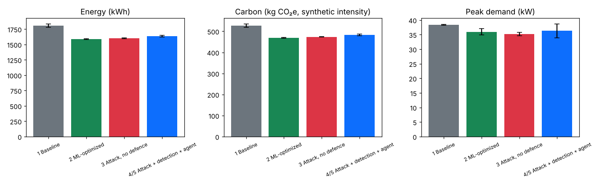
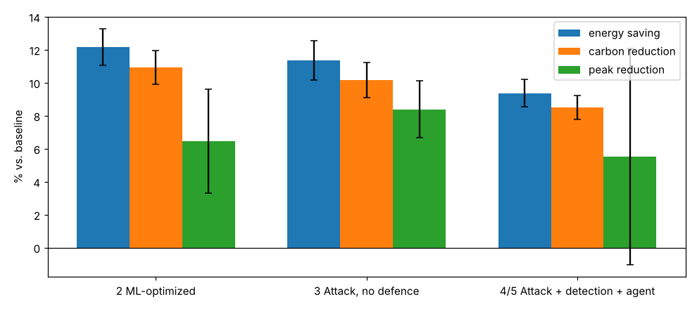
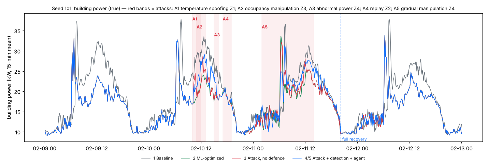
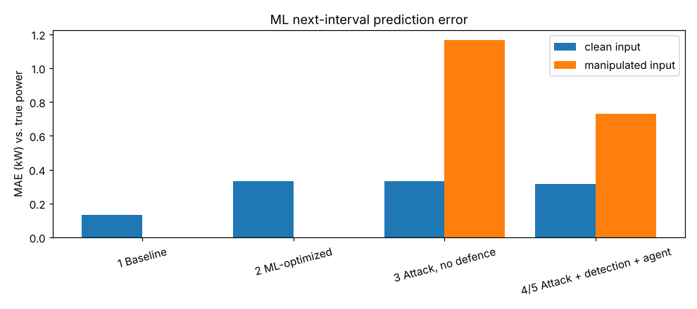
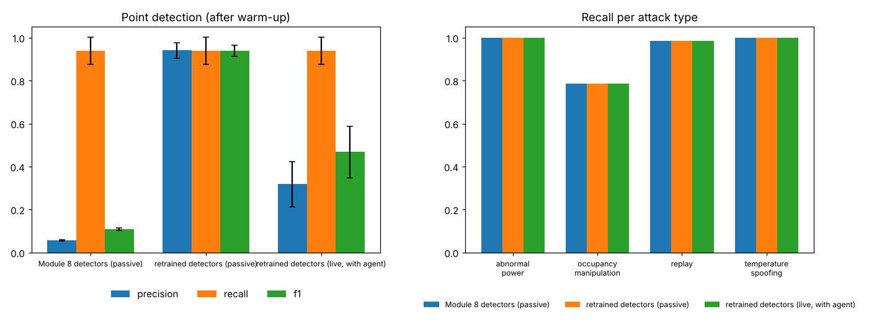
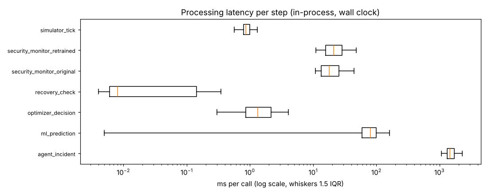

# Module 11: experimental evaluation

Generated by `python -m experiments.evaluation_report` from the raw results in `evaluation/raw/` (produced by `python -m experiments.evaluation --out docs/results/evaluation --optimizer-detectors 20261030T165511Z`, 2026-10-30T17:36:37 UTC, git `cfab6c450`). All values below are computed from those files; nothing is entered by hand.

## Setup

* **Seeds:** 101, 202, 303 — each seed changes occupancy, weather and sensor noise; the four scenarios of a seed share them, so they differ only in control, attacks and defence.
* **Period:** 4 simulated days from 2026-02-09, 5-minute readings, 5 zones. The first 24 h are attack-free warm-up (alerts not investigated, excluded from detection metrics).
* **Scenarios:** 1 baseline schedule control · 2 ML-based optimizer (SciPy SLSQP with the building model `20261030T072815Z` as forecast basis) · 3 optimizer + attacks, no defence · 4/5 optimizer + attacks + live detection, agent (offline rule-based policy — no LLM) with safety validator, sensor isolation and automatic recovery.
* **Attacks** (minutes after start): `temperature_spoofing:Z1:2040:120:offset_c=4`; `occupancy_manipulation:Z3:2100:120:mode=hide`; `abnormal_power:Z4:2340:60:factor=3`; `replay:Z2:2460:120:lag=288`; `gradual_manipulation:Z4:3000:720:rate_c_per_h=0.4`.
* **Detectors:** Module 8 detectors `20261030T082728Z` (trained on baseline-controlled data) and retrained detectors `20261030T165511Z` (trained on 28 days of clean optimizer-controlled simulation, seed 2026, from 2026-01-05).
* **Carbon:** synthetic grid-intensity profile (`MockCarbonProvider`), identical in all scenarios.
* Values are mean ± sample standard deviation over seeds. Full configuration: `config.json`. Notes on how this run was produced: `PROVENANCE.md`.

## 1–2, 5. Energy, carbon, peak demand and comfort (whole period)

| Scenario | Energy (kWh) | Saving vs. baseline | CO₂e (kg) | Reduction | Peak (kW) | Peak reduction | Comfort compliance | Discomfort (°C·h) |
|---|---|---|---|---|---|---|---|---|
| 1 Baseline | 1806.4 ± 29.3 | 0.00 ± 0.00 % | 527.3 ± 7.9 | 0.00 ± 0.00 % | 38.4 ± 0.1 | 0.00 ± 0.00 % | 93.2 ± 0.3 % | 23.8 ± 1.4 |
| 2 ML-optimized | 1586.5 ± 6.4 | 12.16 ± 1.13 % | 469.6 ± 1.9 | 10.92 ± 1.02 % | 35.9 ± 1.1 | 6.44 ± 3.15 % | 94.5 ± 0.6 % | 9.1 ± 1.4 |
| 3 Attack, no defence | 1601.3 ± 4.9 | 11.34 ± 1.20 % | 473.7 ± 1.6 | 10.15 ± 1.07 % | 35.2 ± 0.5 | 8.39 ± 1.73 % | 94.3 ± 1.0 % | 9.6 ± 2.0 |
| 4/5 Attack + detection + agent | 1637.1 ± 14.9 | 9.36 ± 0.84 % | 482.4 ± 4.1 | 8.50 ± 0.74 % | 36.3 ± 2.4 | 5.52 ± 6.58 % | 94.0 ± 1.1 % | 12.6 ± 1.9 |

Comfort compliance: occupied readings (server room excluded) with the true temperature in 20–25 °C.

### Attack period and post-recovery period

| Seed | Attack window | Full recovery (all sensors restored) | Post-recovery window |
|---|---|---|---|
| 101 | 02-10T10:00 → 02-11T14:00 | 02-11T20:15 | 27.8 h |
| 202 | 02-10T10:00 → 02-11T14:00 | 02-12T13:15 | 10.8 h |
| 303 | 02-10T10:00 → 02-11T14:00 | 02-12T15:20 | 8.7 h |

**Attack window** (energy and saving vs. baseline in the same window):

| Scenario | Energy (kWh) | Saving vs. baseline | CO₂e (kg) | Peak (kW) |
|---|---|---|---|---|
| 1 Baseline | 572.6 ± 6.1 | 0.00 ± 0.00 % | 158.6 ± 1.5 | 37.5 ± 0.1 |
| 2 ML-optimized | 487.3 ± 7.0 | 14.89 ± 1.35 % | 137.4 ± 2.0 | 35.9 ± 1.2 |
| 3 Attack, no defence | 502.2 ± 7.5 | 12.29 ± 1.59 % | 141.5 ± 2.1 | 34.3 ± 0.4 |
| 4/5 Attack + detection + agent | 525.6 ± 5.2 | 8.21 ± 1.00 % | 146.9 ± 1.4 | 32.6 ± 0.4 |

**Post-recovery window** (energy and saving vs. baseline in the same window):

| Scenario | Energy (kWh) | Saving vs. baseline | CO₂e (kg) | Peak (kW) |
|---|---|---|---|---|
| 1 Baseline | 263.7 ± 179.5 | 0.00 ± 0.00 % | 81.8 ± 52.4 | 32.3 ± 5.0 |
| 2 ML-optimized | 241.8 ± 165.2 | 8.16 ± 3.20 % | 75.8 ± 48.6 | 27.2 ± 6.5 |
| 3 Attack, no defence | 241.8 ± 165.2 | 8.16 ± 3.20 % | 75.8 ± 48.6 | 27.2 ± 6.5 |
| 4/5 Attack + detection + agent | 241.9 ± 165.3 | 8.09 ± 3.45 % | 75.8 ± 48.6 | 26.7 ± 6.9 |

Savings retention after recovery (defended saving ÷ optimized saving, same window): **98.1 ± 4.2 %**.

## Prediction accuracy (ML next-interval power, vs. the true power)

| Scenario | Predictions | MAE (kW) | RMSE (kW) | Mean power (kW) | MAE, clean input | MAE, manipulated input (n) |
|---|---|---|---|---|---|---|
| 1 Baseline | 17085 | 0.131 | 0.219 | 3.78 | 0.131 | – |
| 2 ML-optimized | 17085 | 0.332 | 0.656 | 3.32 | 0.332 | – |
| 3 Attack, no defence | 17085 | 0.364 | 0.773 | 3.35 | 0.331 | 1.164 (665) |
| 4/5 Attack + detection + agent | 17085 | 0.331 | 0.723 | 3.43 | 0.315 | 0.730 (665) |

Pooled over seeds and zones. 'Manipulated input' = the reading the model used was manipulated by an attack.

## 3–4. Attack detection

| Detectors | Precision | Recall | F1 | FPR | TP | FP | FN | False security alerts per day |
|---|---|---|---|---|---|---|---|---|
| Module 8 detectors (passive) | 0.057 ± 0.003 | 0.939 ± 0.063 | 0.108 ± 0.006 | 29.92 ± 0.76 % | 224 | 3679 | 15 | 181.2 ± 4.7 |
| retrained detectors (passive) | 0.941 ± 0.037 | 0.939 ± 0.063 | 0.939 ± 0.026 | 0.11 ± 0.07 % | 224 | 14 | 15 | 2.7 ± 0.9 |
| retrained detectors (live, with agent) | 0.318 ± 0.105 | 0.939 ± 0.063 | 0.468 ± 0.120 | 4.35 ± 2.19 % | 224 | 535 | 15 | 29.0 ± 12.0 |

Per-reading metrics after the warm-up (gradual manipulation is scored by drift alerts below). False security alerts: attack/anomaly/security-drift alerts outside every attack window (+30 min); data-drift alerts are excluded.

| Attack | Zone | Detection latency (min), Module 8 detectors (passive) | Detection latency (min), retrained detectors (passive) | Detection latency (min), retrained detectors (live, with agent) |
|---|---|---|---|---|
| temperature_spoofing | Z1 | 0 ± 0 (3/3 seeds) | 0 ± 0 (3/3 seeds) | 0 ± 0 (3/3 seeds) |
| occupancy_manipulation | Z3 | 15 ± 9 (3/3 seeds) | 15 ± 9 (3/3 seeds) | 15 ± 9 (3/3 seeds) |
| abnormal_power | Z4 | 0 ± 0 (3/3 seeds) | 0 ± 0 (3/3 seeds) | 0 ± 0 (3/3 seeds) |
| replay | Z2 | 2 ± 3 (3/3 seeds) | 2 ± 3 (3/3 seeds) | 2 ± 3 (3/3 seeds) |
| gradual_manipulation | Z4 | 240 ± 60 (3/3 seeds) | 240 ± 60 (3/3 seeds) | 280 ± 125 (3/3 seeds) |

## 4–5. Corrective action and recovery (attack_defended)

| Attack | Zone | Contained (seeds) | Containment (min after start) | Recovery (min after attack end) | Sensors isolated |
|---|---|---|---|---|---|
| temperature_spoofing | Z1 | 3/3 | 15 ± 0 | 155 ± 69 (3/3 recovered) | temperature |
| occupancy_manipulation | Z3 | 3/3 | 33 ± 14 | 62 ± 40 (3/3 recovered) | occupancy, power_meter |
| abnormal_power | Z4 | 3/3 | 15 ± 0 | 60 ± 0 (3/3 recovered) | power_meter |
| replay | Z2 | 3/3 | 20 ± 0 | 1075 ± 69 (3/3 recovered) | occupancy, temperature |
| gradual_manipulation | Z4 | 3/3 | 170 ± 17 | 375 ± 0 (3/3 recovered) | temperature |

| Seed | Agent incidents | Actions executed | Rejected by safety validator | Restores (recovery policy) | Isolations outside attack windows | Optimizer decisions skipped (zone isolated) |
|---|---|---|---|---|---|---|
| 101 | 47 | 56 | 45 | 8 | 1 | 179 |
| 202 | 63 | 71 | 55 | 10 | 3 | 247 |
| 303 | 57 | 63 | 47 | 10 | 3 | 189 |

## Processing latency

In-process wall-clock time per step (all seeds and scenarios pooled):

| Step | Calls | Mean (ms) | p50 | p95 | p99 | Max |
|---|---|---|---|---|---|---|
| agent_incident | 167 | 1556.04 | 1443.31 | 2276.72 | 2617.70 | 3297.3 |
| ml_prediction | 69120 | 83.57 | 80.93 | 142.62 | 204.94 | 631.6 |
| optimizer_decision | 17108 | 2.13 | 1.34 | 6.79 | 14.19 | 91.7 |
| recovery_check | 3456 | 0.09 | 0.01 | 0.28 | 0.47 | 12.4 |
| security_monitor_original | 17280 | 21.67 | 18.04 | 43.23 | 63.44 | 224.0 |
| security_monitor_retrained | 34560 | 23.94 | 21.03 | 45.03 | 63.67 | 270.8 |
| simulator_tick | 13824 | 1.19 | 0.86 | 2.13 | 8.86 | 55.8 |

Machine: Linux-6.18.44-fc-v185-x86_64-with-glibc2.39, 4 CPUs, Python 3.13.17; scenarios ran in parallel processes, so timings include contention. `agent_incident` = one full LangGraph investigation (tools, safety gate, simulated execution).

**Kafka transport** (`streaming_latency.json`, producer → consumer, real broker):

| Rate (msg/s) | Messages | Mean (ms) | p50 | p95 | p99 | Max |
|---|---|---|---|---|---|---|
| 5.0 | 1000 | 22.64 | 21.64 | 22.89 | 24.60 | 513.3 |
| 50.0 | 1000 | 23.80 | 21.17 | 23.57 | 305.74 | 505.6 |
| 500.0 | 1000 | 73.75 | 13.96 | 409.04 | 488.66 | 512.7 |

## Figures

## Limitations

* Simulated building and simulated attacks; carbon intensity is synthetic.
* The agent uses the deterministic offline policy (no LLM) so runs are reproducible; Claude is not evaluated here.
* 3 seeds of 4 days each; standard deviations over so few seeds are rough.
* Latencies are in-process on one machine; they exclude Kafka and database round trips except in the Kafka table.
