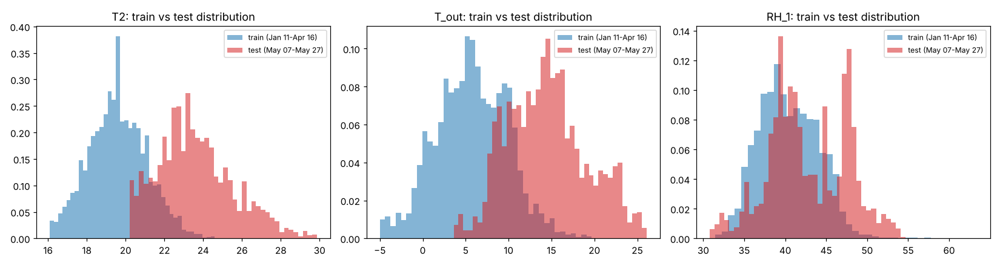
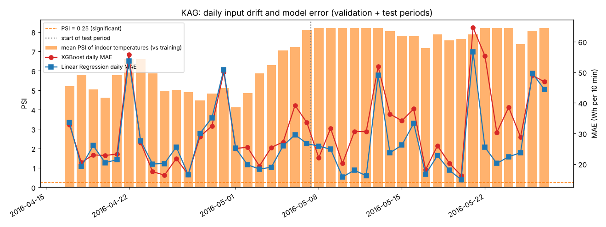

# KAG dataset: data-drift analysis

Generated by `python -m experiments.kag_drift_analysis` on 2026-10-30T12:26:16.377798+00:00. All values are computed from the data.

* Dataset: `KAG_energydata_complete.csv` (19735 rows, SHA-256 `2820bf712ad0275cb18b85a05250926100d8e65ebb9f4d2d016ca91ea152a25d`).
* Periods (same chronological split as the Module 6 model): train until 2016-04-16 22:30, validation until 2016-05-07 08:10, test afterwards.
* PSI levels: < 0.1 stable, 0.1-0.25 moderate, >= 0.25 significant.

## Summary

* Test vs. train: 21 of 26 features drift significantly (PSI >= 0.25); 26 differ by the KS test (p < 0.01).
* Indoor temperatures: mean PSI 7.45; on average 38.7% of test values lie outside the range seen in training (tree models predict as if they were at the edge of the range).
* Target `Appliances`: PSI 0.334 (significant).
* Spearman correlation, psi vs xgb minus linear mae (daily, n=41): rho = 0.63, p = 0.000.
* Spearman correlation, outside range vs xgb minus linear mae (daily, n=41): rho = 0.69, p = 0.000.

## Train vs. test (top 12 by PSI)

| Feature | Train mean | Other mean | KS D | KS p | PSI | Level | Outside train range |
|---|---|---|---|---|---|---|---|
| T7 | 19.39 | 23.78 | 0.987 | 0.0e+00 | 8.286 | significant | 54.7% |
| T1 | 21.07 | 24.24 | 0.931 | 0.0e+00 | 8.253 | significant | 55.5% |
| T9 | 18.60 | 23.06 | 0.997 | 0.0e+00 | 8.240 | significant | 18.3% |
| T4 | 19.97 | 24.21 | 0.980 | 0.0e+00 | 8.192 | significant | 65.1% |
| T3 | 21.43 | 25.55 | 0.938 | 0.0e+00 | 7.848 | significant | 10.9% |
| T8 | 21.34 | 24.66 | 0.802 | 0.0e+00 | 6.547 | significant | 29.4% |
| T5 | 18.81 | 22.73 | 0.894 | 0.0e+00 | 6.324 | significant | 49.5% |
| T2 | 19.59 | 23.60 | 0.761 | 0.0e+00 | 5.918 | significant | 26.6% |
| RH_6 | 67.28 | 22.89 | 0.655 | 0.0e+00 | 5.077 | significant | 0.0% |
| T_out | 5.72 | 14.52 | 0.670 | 0.0e+00 | 4.169 | significant | 15.5% |
| T6 | 5.97 | 16.05 | 0.694 | 0.0e+00 | 3.473 | significant | 23.4% |
| Tdewpoint | 2.76 | 9.34 | 0.651 | 0.0e+00 | 3.383 | significant | 32.2% |

## Train vs. validation (top 12 by PSI)

| Feature | Train mean | Other mean | KS D | KS p | PSI | Level | Outside train range |
|---|---|---|---|---|---|---|---|
| RH_6 | 67.28 | 26.61 | 0.650 | 0.0e+00 | 4.966 | significant | 0.0% |
| T9 | 18.60 | 20.08 | 0.545 | 0.0e+00 | 3.958 | significant | 0.0% |
| RH_3 | 39.80 | 36.05 | 0.616 | 0.0e+00 | 3.678 | significant | 0.7% |
| T5 | 18.81 | 20.14 | 0.504 | 0.0e+00 | 3.271 | significant | 0.0% |
| T3 | 21.43 | 22.94 | 0.490 | 0.0e+00 | 3.229 | significant | 1.0% |
| T7 | 19.39 | 20.89 | 0.426 | 0.0e+00 | 3.156 | significant | 1.1% |
| RH_4 | 39.46 | 35.07 | 0.522 | 0.0e+00 | 3.109 | significant | 1.2% |
| T4 | 19.97 | 21.69 | 0.457 | 0.0e+00 | 2.416 | significant | 3.0% |
| RH_9 | 41.95 | 37.94 | 0.441 | 0.0e+00 | 2.186 | significant | 3.0% |
| T8 | 21.34 | 22.64 | 0.379 | 5.6e-314 | 1.919 | significant | 0.0% |
| RH_8 | 43.31 | 39.60 | 0.362 | 1.8e-285 | 1.790 | significant | 0.0% |
| RH_7 | 35.60 | 31.38 | 0.450 | 0.0e+00 | 1.660 | significant | 0.0% |

## Daily timeline

Note: one day of readings is much narrower than four months of training data, so daily PSI is high even without a seasonal change (it also measures the concentration of a single day). Read the *trend* and the share of values outside the training range, not the absolute PSI level.

| Day | Mean PSI indoor temp. | Outside train range | Mean indoor temp. (°C) | MAE XGBoost | MAE Linear |
|---|---|---|---|---|---|
| 2016-04-17 | 5.21 | 0.0% | 21.62 | 32.9 | 33.5 |
| 2016-04-18 | 5.79 | 0.0% | 21.31 | 20.5 | 19.1 |
| 2016-04-19 | 5.03 | 0.0% | 21.09 | 23.0 | 26.0 |
| 2016-04-20 | 4.61 | 0.0% | 21.35 | 22.8 | 20.4 |
| 2016-04-21 | 5.78 | 0.0% | 21.72 | 23.2 | 21.4 |
| 2016-04-22 | 6.60 | 2.4% | 22.21 | 55.7 | 53.7 |
| 2016-04-23 | 6.60 | 0.0% | 22.05 | 27.0 | 27.5 |
| 2016-04-24 | 5.87 | 0.0% | 21.47 | 17.5 | 20.0 |
| 2016-04-25 | 4.97 | 0.0% | 20.92 | 16.3 | 20.1 |
| 2016-04-26 | 5.01 | 0.0% | 20.58 | 21.8 | 25.5 |
| 2016-04-27 | 4.90 | 0.0% | 20.27 | 16.5 | 16.5 |
| 2016-04-28 | 4.47 | 0.0% | 20.15 | 29.0 | 30.0 |
| 2016-04-29 | 4.83 | 0.0% | 20.09 | 32.4 | 35.1 |
| 2016-04-30 | 5.12 | 0.0% | 20.61 | 50.1 | 50.9 |
| 2016-05-01 | 4.11 | 0.0% | 20.74 | 25.1 | 25.2 |
| 2016-05-02 | 4.86 | 1.6% | 21.34 | 25.4 | 19.7 |
| 2016-05-03 | 5.87 | 2.1% | 21.96 | 19.3 | 18.3 |
| 2016-05-04 | 6.30 | 2.3% | 22.20 | 25.4 | 18.9 |
| 2016-05-05 | 7.05 | 3.8% | 22.48 | 27.2 | 26.0 |
| 2016-05-06 | 7.21 | 20.1% | 22.86 | 39.2 | 29.6 |
| 2016-05-07 | 8.10 | 26.0% | 23.71 | 33.5 | 26.7 |
| 2016-05-08 | 8.21 | 51.0% | 24.41 | 22.0 | 25.8 |
| 2016-05-09 | 8.21 | 60.2% | 24.59 | 31.7 | 24.8 |
| 2016-05-10 | 8.21 | 74.7% | 24.86 | 20.2 | 15.8 |
| 2016-05-11 | 8.21 | 78.6% | 25.04 | 30.6 | 17.9 |
| 2016-05-12 | 8.21 | 81.2% | 25.02 | 30.6 | 16.2 |
| 2016-05-13 | 8.21 | 83.3% | 25.35 | 51.8 | 49.0 |
| 2016-05-14 | 8.04 | 67.8% | 24.32 | 36.3 | 23.6 |
| 2016-05-15 | 7.80 | 34.5% | 23.57 | 34.1 | 26.2 |
| 2016-05-16 | 7.77 | 5.3% | 23.28 | 38.0 | 33.3 |
| 2016-05-17 | 7.16 | 8.7% | 23.06 | 18.1 | 16.7 |
| 2016-05-18 | 7.88 | 0.3% | 23.03 | 26.0 | 22.8 |
| 2016-05-19 | 7.58 | 3.7% | 23.10 | 20.2 | 18.0 |
| 2016-05-20 | 7.64 | 5.2% | 23.01 | 16.2 | 14.9 |
| 2016-05-21 | 7.87 | 28.6% | 23.70 | 64.6 | 56.7 |
| 2016-05-22 | 8.21 | 51.1% | 24.25 | 55.3 | 25.4 |
| 2016-05-23 | 8.21 | 26.2% | 23.94 | 30.3 | 20.2 |
| 2016-05-24 | 8.21 | 26.3% | 23.76 | 38.5 | 22.4 |
| 2016-05-25 | 7.39 | 13.6% | 23.18 | 28.8 | 23.7 |
| 2016-05-26 | 8.05 | 30.4% | 23.83 | 49.0 | 49.7 |
| 2016-05-27 | 8.21 | 46.8% | 24.26 | 46.9 | 44.4 |

## Figures

